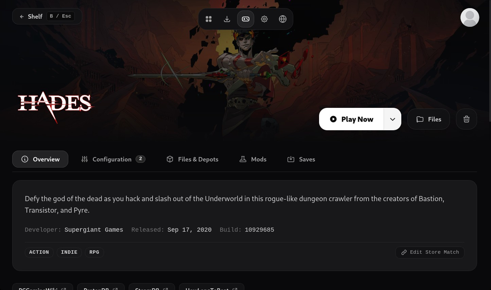
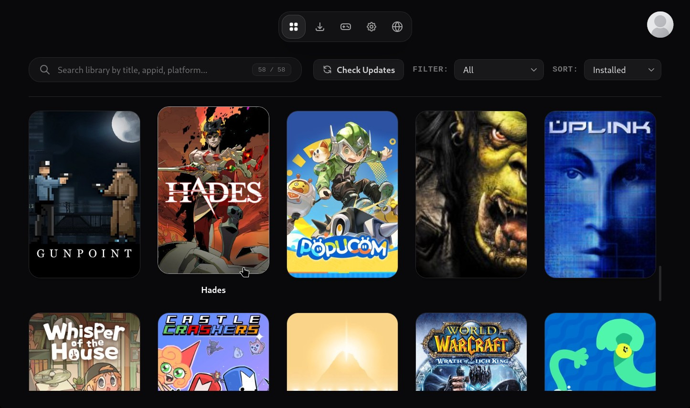
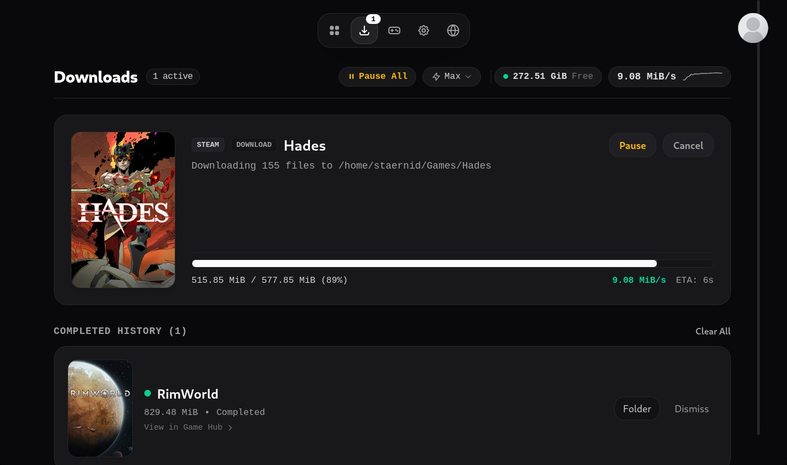
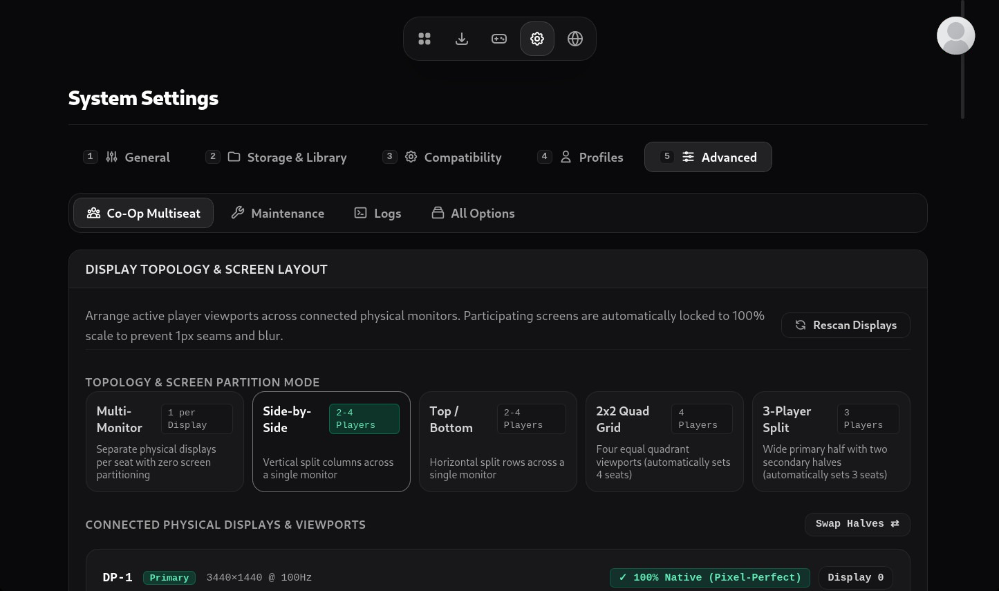

# gamux

An advanced game manager for Linux that supports:

- **Library Management**: Filter and search through multiple libraries of games that you own
- **Launching**: Native Linux games and Windows titles via Proton/Wine/UMU
- **DRM Handling**: Play your games offline. Steam manifest scanning, depot downloading, SteamStub unpacking and gbe_fork emulator integration
- **Profiles & Sandboxing**: Multi-profile prefix isolation using bwrap
- **Local Multiseat / Split-Screen:** Sandboxed multi-instance gaming with dedicated audio routing (PipeWire) and controller/input assignments (evdev/Gamescope)
- **Save & Mod Management (WIP)**: Save management using the Ludusavi Manifest + Steam Workshop mod handling

## Dev Notes

- **Tagging & Releasing**: Follow Semantic Versioning (`vMAJOR.MINOR.PATCH`, e.g. `v2.0.0` -> `v2.0.1` / `v2.1.0`). Create and push annotated tags (`git tag -a v2.0.0 -m "v2.0.0: ..." && git push origin v2.0.0`) to trigger GitHub Actions automated builds and releases.

Reference https://steamwebapi.azurewebsites.net/

## Legal

All game titles, cover art, logos, and trademarks shown in screenshots are the property of their respective owners and are used purely for demonstration purposes.
