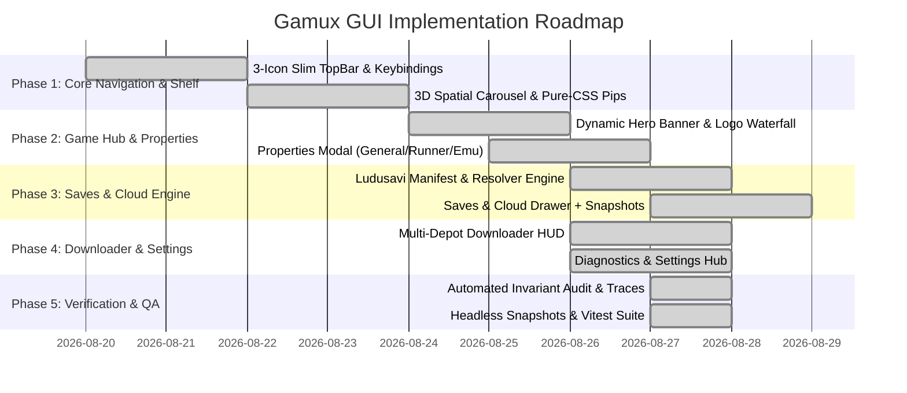

# Gamux GUI Design & UX Specification

> **Version**: 2.3  
> **Target Platforms**: Linux Desktop (X11/Wayland) & Steam Deck / Handheld PCs (1280×800 to 4K)  
> **Stack**: Wails v2 (Go WebKit runtime) + Svelte 5 / Tailwind CSS  
> **Status**: Production / Implemented  

---

## 1. Executive Summary & Design Vision

**Gamux** is a premier post-download Steam game manager and launcher for Linux. It combines automated Goldberg Steam Emulator integration, Steamless DRM stripping, native/Wine/Proton runner management (`umu-run`), direct Steam depot downloading, rich artwork waterfall resolution, and native Ludusavi-powered save/configuration discovery and cross-device backup snapshots.

### The "Curated Shelf" Discovery Philosophy
Unlike conventional game launchers that overwhelm the player with an endless wall of small icons or dense database tables, Gamux adopts a **curated console shelf philosophy**:
- **Intentional Library Discovery**: The primary library interface is centered around a focused **3D Spatial Carousel (Cover Shelf)**. By presenting games with physical depth, card tilt, and prominent artwork, it mimics flipping through physical game cartridges or vinyl records.
- **Zero Choice Fatigue**: Massive grids and spreadsheets create decision fatigue. Gamux deliberately avoids permanent dense grid/list views for main browsing. Instant search and filtering is available on-demand via the Search Overlay (`/` or `Ctrl+K`), keeping the primary experience immersive, elegant, and clutter-free.
- **Confident, Clean Game Hub**: When entering a game's hub, the player is presented with a cinematic hero experience. Runner settings and technical knobs belong cleanly inside **Game Properties (`X`)**, keeping the primary screen focused on immersion, play status, achievements, DLCs, and patch notes without unnecessary inline clutter.

---

## 2. Global Navigation: The Streamlined 3-View Architecture

To keep the interface razor-sharp and aligned with industry standards (Steam Deck / Big Picture):
- The global navigation is streamlined to **3 primary views**:
  1. **Shelf / Library (`1`)**: The curated 3D game carousel.
  2. **Tasks (`2`)**: All active depot acquisitions, DRM/GBE setup pipelines, integrity checks, and maintenance queues.
  3. **Settings Hub (`3`)**: Global runners, Goldberg defaults, library paths, save & backup preferences, tools, and system configuration.
- **Activity & Telemetry Migration $\rightarrow$ Settings Diagnostics**:
  - The previous standalone "Activity" view is unified into **Tasks** (for in-flight transfers and operations) and **Settings $\rightarrow$ Logs & Diagnostics** (for persistent history and error auditing).
  - Terminal stdout/stderr is mirrored 1:1 with structured log filtering (Info, Warn, Error) in the settings log viewer.

```text
┌─────────────────────────────────────────────────────────────────────────────┐
│                              Global Top Bar                                 │
│  [Gamux]       [ ◀ Q/L1   (1) Shelf    (2) Tasks    (3) Settings   E/R1 ▶ ]       [Search /]  │
└───────────────────────────────────────┬─────────────────────────────────────┘
                                        │
     ┌──────────────────────────────────┼──────────────────────────────────┐
     ▼                                  ▼                                  ▼
┌──────────────────────────┐ ┌──────────────────────────┐ ┌──────────────────────────┐
│   Curated Shelf (Main)   │ │        Tasks View        │ │      Settings Hub        │
│ ┌──────────────────────┐ │ │ ┌──────────────────────┐ │ │ ┌──────────┬───────────┐ │
│ │ 3D Spatial Carousel  │ │ │ │ Minimalist HUD / Cap │ │ │ │ Nav Menu │ Content   │ │
│ │ • 5-Card Depth Arc   │ │ │ ├──────────────────────┤ │ │ │ • System │ Forms,    │ │
│ │ • Snappy 60fps GPU   │ │ │ │ Transfers & Ops Cards│ │ │ │ • Runners│ Toggles,  │ │
│ │ • Status Pips/Shield │ │ │ │ • High-Legibility Art│ │ │ │ • GBE Emu│ Saves/Bkp,│ │
│ ├──────────────────────┤ │ │ ├──────────────────────┤ │ │ │ • Tools  │ & System  │ │
│ │ Bottom HUD & Quick / │ │ │ │ Filter Tabs & Queue  │ │ │ │ • Logs   │ Stream    │ │
│ └──────────┬───────────┘ │ │ └──────────────────────┘ │ │ └──────────┴───────────┘ │
└────────────┼─────────────┘ └──────────────────────────┘ └──────────────────────────┘
             ▼ (A / Enter)
┌─────────────────────────────────────────────────────────────────────────┐
│                              Game Hub Screen                                │
│ ┌─────────────────────────────────────────────────────────────────────────┐ │
│ │ Dynamic Full-Bleed Hero Banner & Logo Overlay                           │ │
│ │                                                                         │ │
│ │ [▶ PLAY NOW (A)]             [📁 Files (Y)]       [⚙ Properties (X)]    │ │
│ ├─────────────────────────────────────────────────────────────────────────┤ │
│ │ Tabs: [Overview]            [News]                 [Integrity]          │ │
│ │ Quick Actions: [Properties]   [Saves & Backups]    [Artwork]   [Logs]   │ │
│ └─────────────────────────────────────────────────────────────────────────┘ │
└─────────────────────────────────────────────────────────────────────────────┘
```

---

## 3. Screen-by-Screen Detailed Design Specifications

### 3.1. Curated Shelf / Carousel Screen (`/` or `?view=library`)

The primary home screen of Gamux is the **Curated Shelf**.

#### Performance & Visual Mechanics:
1. **Zero-Lag Hardware-Accelerated 3D Carousel**:
   - 5 cards rendered along a smooth parabolic depth curve with hardware-accelerated GPU transforms (`translate3d`, `rotateY`, `scale`, `opacity`).
   - Store updates only fire upon settling (`< 0.15` delta) to eliminate layout recalculations and preserve locked 60+ FPS scrolling.
   - Snappy rotary wheel scrubbing on gamepad right stick and instant keyboard/D-pad stepping (`← / →`, `A / D`).
2. **Lightweight Pure-CSS Status Pips**:
   - Top-Left: Store/Origin badge (`STEAM`, `GOG`).
   - Top-Right: Discreet status pip (zero GPU/CPU re-render cost):
     - **Emerald Shield**: Goldberg Patched & Ready.
     - **Green Pulse**: Game Currently Running.
     - **Amber Pip**: Clean Steam DRM / Initial Setup Pending.
     - **Cyan Arrow**: Active Download / Update in progress.
3. **Bottom Telemetry & Command HUD**:
   - Bottom-Left: Clear controller button map (`A / ↵ Game Hub`, `Y Files`, `/ Search`).
   - Bottom-Right: Monospace technical details (`Size: 68 GiB`, `Platform: Windows (Wine/UMU)`, `Path: ...`).
4. **On-Demand Search Modal (`/` or `Ctrl+K`)**:
   - Instant search overlay when jumping directly to a title, returning seamlessly to the carousel once selected.

---

### 3.2. Game Hub Screen (`?view=game-hub`)

When a game is selected from the shelf, Gamux transitions smoothly into the **Game Hub**.

#### Key Elements:
1. **Dynamic Ambient Hero Header**:
   - High-resolution hero backdrop art (`hero.jpg` or `banner.jpg`) with a smooth gradient vignette that maintains crisp readability.
   - High-res game logo overlay (`logo.png`) with clean typography fallback.
   - Clean metadata line: `Steam #1091500 · Windows · 68 GiB · Goldberg Patched`.
2. **Primary Action Block**:
   - Prominent **Play Now** CTA (or **Stop Game** if running; **Setup & Play** if first-time).
   - Fast secondary actions: `Open Game Folder (Y)` and `Game Properties (X)`.
3. **Deep Tab Modules (Single-Word, Minimalist)**:
   - **Overview**: Summary telemetry, environment breakdown, and quick action cards (`Properties`, `Saves & Backups`, `Change Grid Artwork`, `Launch Logs`, `Re-link Metadata`).
   - **News**: Expandable changelog entries fetched directly from Steam Web API with formatted markdown/BBCode rendering.
   - **Integrity**: Official Steam manifest integrity scan (SHA-1 checksums), missing file repair, and folder name normalization.

---

### 3.3. Game Properties & Compatibility Modal (`game-properties`)

The centralized configuration modal for per-game launch options, graphics overrides, and data management.

#### Modal Tab Structure (Single-Word, Minimalist):
1. **General**:
   - Target Executable selector (auto-detected candidates with custom file picker).
   - Custom Launch Flags / CLI Arguments input.
   - Store & Artwork Identity association.
   - Per-Game Custom Environment Variables key-value table.
   - Dangerous Operations: `Rollback Patches` (reverts Goldberg emulator and Steamless unbundling to original files).
2. **Runner**:
   - Compatibility Runner selection (`UMU`, `Proton-GE`, `Wine Staging`, `Linux Native`).
   - Wine Prefix directory override (with UMU default hierarchy support).
   - DXVK / VKD3D / FSR runtime toggles.
   - MangoHud overlay activation.
3. **Emulator**:
   - Goldberg Operating Mode (`Loader Mode (Non-destructive)` vs `Portable Mode (In-place DLLs)`).
   - GSE Player Persona overrides (`Account Name`, `SteamID64`, `Language`).
   - DLC Management: toggle individual DLCs or automatically unlock all known DLC AppIDs.
4. **Saves**:
   - **Telemetry Cards**: Total save size on disk, discovered path counts, Steam Cloud status, snapshot archives count.
   - **Discovered Directories List**:
     - **Save Data**: Local save paths resolved via the Ludusavi database.
     - **Configuration**: Local config folders and registry keys.
     - **Goldberg Cloud**: Emulated Steam Cloud directory (`~/.local/share/GSE Saves/<appid>/remote`).
     - **Portable Saves**: In-tree game directory saves if detected.
     - Actions: `Open in File Manager` and `Copy Path` (with copy feedback tooltip).
   - **Snapshot History & Backup Manager**:
     - `+ Create Backup`: Takes timestamped portable `.zip` snapshot with optional note.
     - Cross-device portability: uses `backup_meta.json` with semantic placeholder resolution for PC $\leftrightarrow$ Steam Deck restoration.
     - Actions: `Restore Snapshot` (with overwrite confirmation) and `Delete Snapshot`.
     - `Refresh Manifest`: Forces on-demand update of the Ludusavi database from GitHub.
5. **Logs**:
   - Monospace log viewer displaying command execution, environment, PID, and process termination exit codes.

---

### 3.4. Tasks Center (`?view=tasks` or `?view=downloads`)

The Tasks Center is a unified, minimalist operational hub supervising all background activities: Steam depot downloads, Goldberg DRM setups, Steamless unpacks, integrity verifications, tool updates, and rollbacks.

#### Design Elements & Philosophy:
1. **Ultra-Clean Header & Telemetry HUD**:
   - Clean, uncluttered title **Tasks** with a static status counter (e.g. `2 active · 1 queued`). Strictly **zero flashing pips or animated blinking**.
   - Integrated bandwidth telemetry chip with mini SVG sparkline (displayed only when active transfers occur).
   - Minimalist speed limiter selector (`Cap: Unlimited ▾`).
   - Muted, compact Storage Capacity bar (`/home/.../Games` - Free vs Used) styled in dark slate/cyan tones without garish neon highlights.
   - Clean `+ New Download` button matching the app's minimal button styling.
2. **Minimalist Segmented Filter Tabs**:
   - `All (N)` · `Downloads (N)` · `Operations (N)` · `Completed (N)`.
3. **Unified Active Task Cards (High Legibility & Visual Clarity)**:
   - **Poster Artwork Thumbnail**: Displays vertical game capsule art on the left for instant visual recognition on Steam Deck / Handheld displays.
   - **Header & Store Badges**: Clean typography with Store origin (`STEAM`, `GOG`), AppID, and Task Type badge (`DOWNLOAD`, `INTEGRITY SCAN`, `SETUP & DRM`, `TOOL UPDATE`).
   - **Progress & Stage Ticker**:
     - Monospace step details (`Resolving Manifests ➔ Downloading Chunks (3,400/5,000) ➔ Verifying SHA-1`).
     - Smooth progress bar with clear contrast.
     - Formatted throughput (`34.2 GiB / 48.5 GiB (69%) · 24.0 MiB/s · ETA: 10m 50s`).
   - **Granular Depot Inspector**: Collapsible drawer showing individual depot chunks without cluttering the main card view.
   - **Gamepad-Friendly Controls**: Clear, high-contrast `Pause`, `Resume`, and `Cancel` buttons.
4. **Queued & Paused Tasks**:
   - Compact, legible rows with clear state badges (`QUEUED`, `PAUSED`) and instant resume/cancel actions.
5. **Completed History**:
   - Concise finished log with 1-click `Play Game`, `Open Folder`, `View Log`, and `Dismiss` actions, plus a `Clear All` button.
6. **"Add Download" Modal Wizard**:
   - Fast title search with Steam autocomplete and app capsule previews.
   - Destination folder selector with free disk space check.
   - Post-setup auto-DRM toggle.

---

### 3.5. System Settings & Diagnostics Hub (`?view=settings`)

The Settings view provides centralized configuration with a modern two-column master-detail layout.

#### Navigation Categories:
1. **General & Interface**:
   - UI Scale factor (Handheld 18px / Standard 16px / Compact 14px).
   - Gamepad navigation sound effects (Enable / Disable).
   - Desktop notifications on game launch / update.
2. **Library Paths & Directories**:
   - Manage multiple game storage folders (e.g. `/home/user/Games`, `/run/media/mmcblk0p1/SteamLibrary`).
   - Auto-scan on launch toggle.
   - One-click "Batch Setup Clean Games" for newly discovered games.
3. **Compatibility & Runners**:
   - Default Linux runner (`UMU`, `Proton-GE`, `Wine Staging`, `Native`).
   - Default Wine Prefix directory (`~/Games/umu/umu-default` / `~/.local/share/wineprefixes`).
   - Global Environment Variables manager (applied to all launched titles).
   - Global Graphics Overlays (MangoHud default on/off).
4. **Goldberg Emulator & Steamless Defaults**:
   - GSE Player Persona (`Account Name`, `SteamID64`, `Language`, `Country Code`).
   - Default Goldberg Mode (`Loader Mode (Non-destructive)` vs `Portable Mode (Replace DLLs)`).
   - Steamless SteamStub DRM unpacker automatic extraction toggle.
5. **Saves & Backups Configuration**:
   - Auto-Backup on Game Exit toggle (`auto_backup_saves`).
   - Rolling Snapshot Retention count (`backup_retention_count`, default: 5).
   - Central Backup Directory (`backup_dir`, default: `~/.local/share/gamux/backups`).
   - Ludusavi Save Manifest upstream URL (`save_manifest_url`).
6. **Tool & Dependency Manager**:
   - Status cards for bundled and external tools (`Goldberg Fork`, `Steamless-rs`, `UMU Launcher`, `MangoHud`).
7. **System Logs & Diagnostics (Migrated Activity)**:
   - Live monospace terminal log stream of Go engine events, launch profiles, and rollback traces.
   - Level filters (`All`, `Info`, `Warning`, `Error`).
   - 1-click `Clear Log` and `Copy Diagnostics` buttons for issue reporting.

---

## 4. Implementation Status & Roadmap



### Verification Gate Summary:
- **Go Unit & Race Tests**: `go test -race ./...` (All packages passing cleanly).
- **Svelte Type Validation**: `svelte-check` (0 errors, 0 warnings).
- **Vitest & Invariant Audits**: 17/17 test suites, 70/70 tests passing.
- **Headless UI Snapshot Verification**: Captured and verified across all views in `.gui-snapshots/`.
